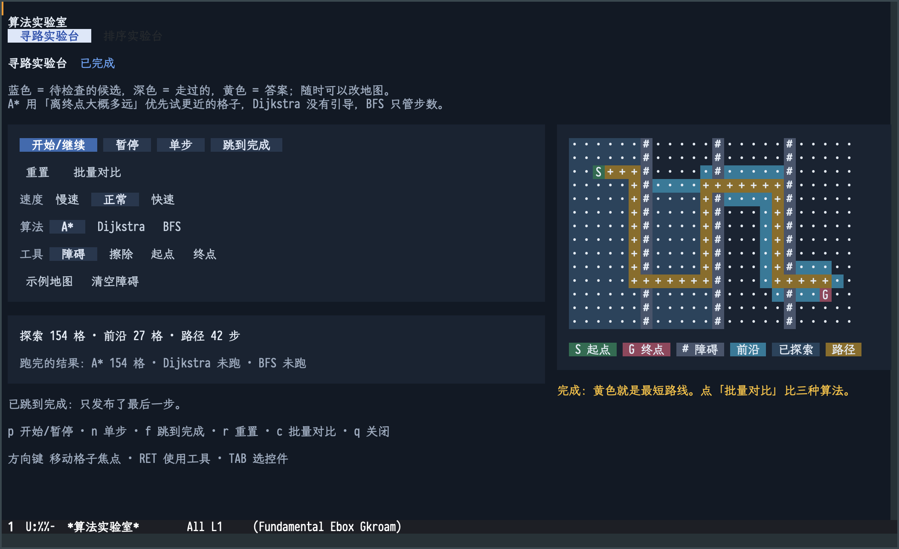

# etaf-algo-lab

Learn algorithms by watching them, steering them and comparing them — inside Emacs.

`etaf-algo-lab` is a normal ETAF application above `etaf` and `etaf-ui`. It is not
a single demo: one shared player runs any number of laboratories, and every
laboratory describes only its own algorithm and cells.

The pathfinding laboratory at a wide frame:



## What it is for

| Level | Who | What the workspace gives |
| --- | --- | --- |
| Learn | No prior knowledge | Plain-language introduction, live narration of the current phase, and a one-step-at-a-time animation that explains itself |
| Feel | You know the algorithm | Play, pause, single step, change speed and data, switch algorithms, watch the counters move |
| Explore | You want to compare or question | **批量对比** runs every algorithm headlessly on the current input and reports their real work counts side by side |

Nothing here assumes a textbook. Colors, vocabulary and the difference between
the algorithms are stated on screen, and every counter is paired with a sentence.

## Laboratories

| Laboratory | Algorithms | Board |
| --- | --- | --- |
| 寻路实验台 | A* (Manhattan heuristic), Dijkstra, BFS | editable grid with walls, start and goal |
| 排序实验台 | bubble, insertion, selection, bottom-up merge | 14-bar chart of one fixed input |

## Usage

Add this repository root and the ETAF, ETAF UI, Ebox and ECSS roots to
`load-path`, then load the package and open the workspace:

```elisp
(require 'etaf-algo-lab)
(etaf-algo-lab-open)          ; default laboratory
(etaf-algo-lab-open 'sorting) ; a specific laboratory
(etaf-algo-lab-labs)          ; ('pathfinding 'sorting)
```

`M-x etaf-algo-lab-open` selects the default laboratory; with a prefix argument
it asks by title. `M-x etaf-algo-lab-close` releases the workspace.

| Key | Action |
| --- | --- |
| `p` | start or pause |
| `n` | one step |
| `f` | jump to the end without animation |
| `r` | reset the current laboratory |
| `c` | batch comparison |
| `q` | close |
| `?` | searchable, read-only keyboard help in the same buffer |
| arrows, `RET`, `TAB` | move cell focus, use the cell tool, reach the controls |

Every laboratory's own hint line is appended to that list, so the keyboard
surface is always visible. Help lists the effective player bindings and the
current laboratory's description without splitting the window. Search keeps
shortcut letters as text; Escape exits search before closing help, and clicking
the shade also closes it. Both restore focus without changing the laboratory.
Animation continues underneath help; opening or closing it does not pause or
resume the player.

## Layout

```
etaf-algo-lab.el              entry: public API and autoloads
lisp/etaf-algo-lab-app.el     application layer: catalog, buffer, lifecycle
lisp/etaf-algo-lab-player.el  laboratory contract, playback and control surface
lisp/etaf-algo-lab-pathfinding.el  laboratory: search engine + adapter
lisp/etaf-algo-lab-sorting.el      laboratory: sort machines + adapter
lisp/etaf-algo-lab-theme.el   shared palette
```

The player owns play/pause/step/finish/reset/speed, the bounded timer, the live
lines, the comparison run, the scoped key declarations and cleanup. A laboratory
supplies a model, one `step`, a terminal predicate, and presentation callbacks. The board
itself comes from the catalog: `etaf-ui`'s `etaf-tile-grid`.

Dependencies point one way: `app` → laboratories → `player` → `etaf`/`etaf-ui`.
Adding a laboratory means adding one file that registers a laboratory record;
the player, keys, comparison button and layout come for free.

## Performance

One animation step updates only the cells, counters and lines it changed: the
board's Hosts stay mounted and Ebox rewrites just their buffer segments. The
step budget is 100 ms. Three batch sets of 10 samples measure
`algolab.pathfinding.step.callback` at p50 1.6 ms and p95 2.1 ms.

A hidden window, a finished laboratory and a closed or replaced buffer all
stop the animation, and one timer per mount is the only scheduled work. `make gui` and the shared driver measure the real
step; `benchmarks/performance-scenarios.el` registers the workloads:

```sh
python3 ../scripts/performance.py run --mode gui --server <owned-server> \
  --scenario-file benchmarks/performance-scenarios.el \
  --scenario 'algolab.*' --sets 3 --samples 30 --warmups 5
```

## Checks

```sh
make check   # structure, compilation, public acceptance, API boundary
make gui     # 24 real GUI actions in an existing owned server; prints evidence
```

`make gui` writes window-only screenshots plus `result.json`. A passing run
proves the functional assertions only; review the images, and treat background
timing as a screen rather than a foreground latency certificate.

Two environment traps worth knowing before rerunning the GUI checks: a
full-screen frame ignores `set-frame-size` (the scenario clears that state
first), and the performance driver refuses packages edited or rebuilt after
the verification instance started, so compile before starting the instance.
